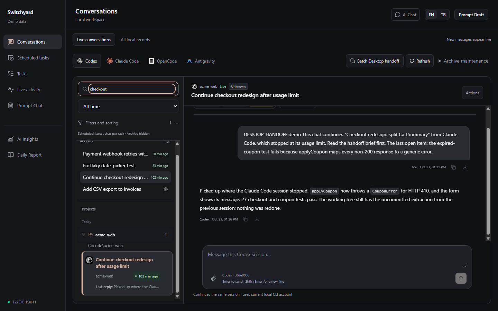
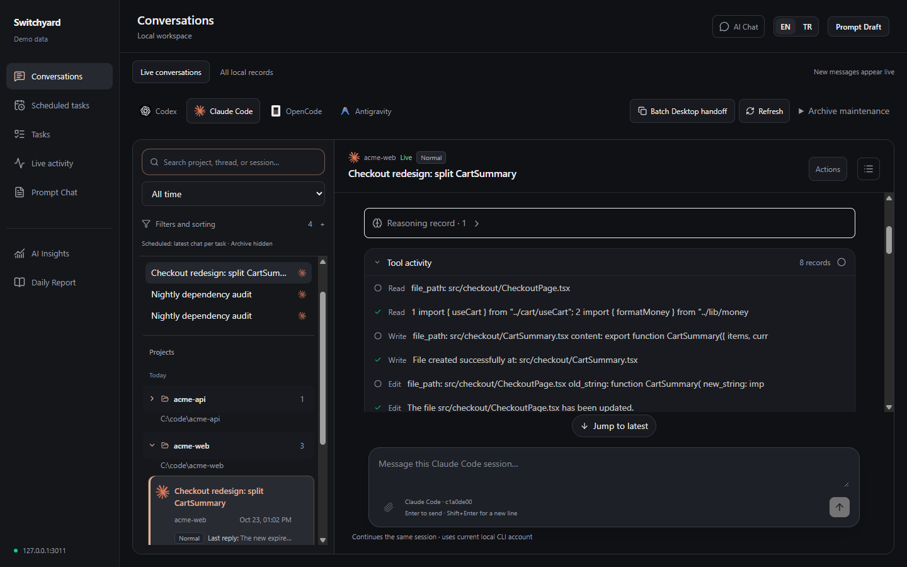
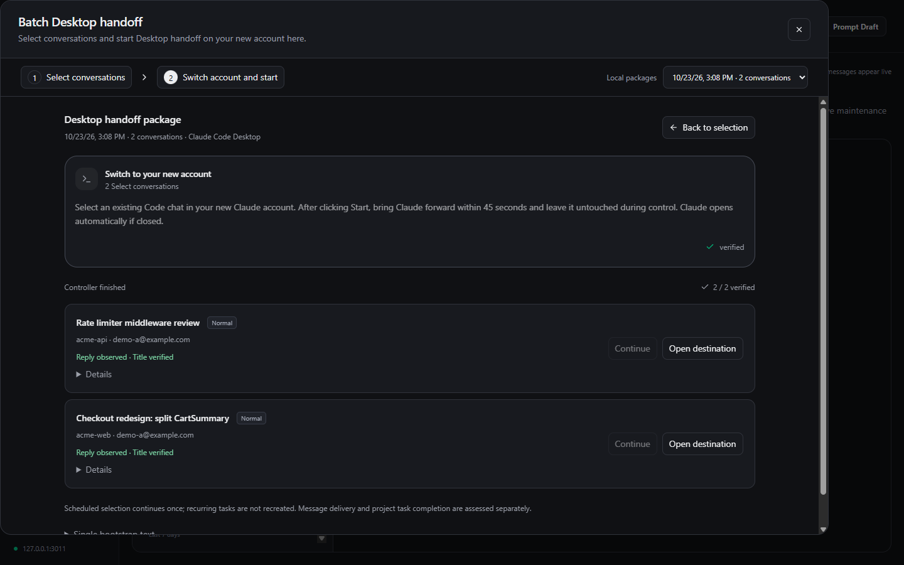
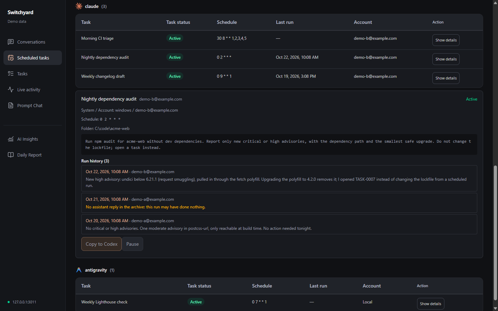
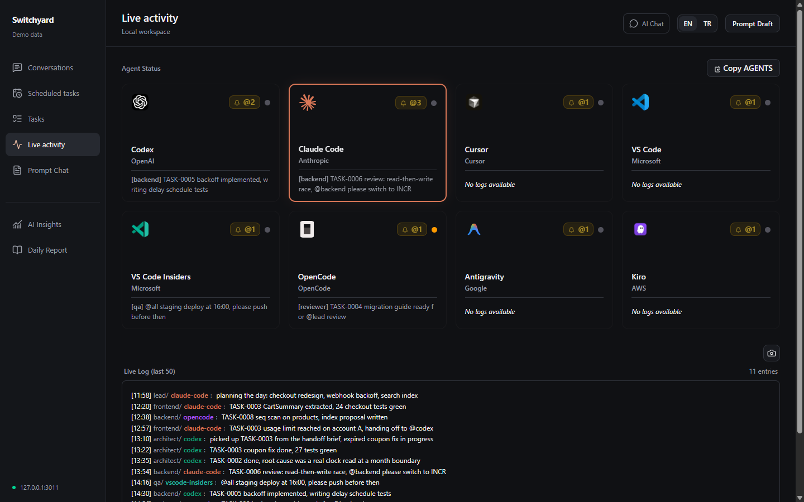
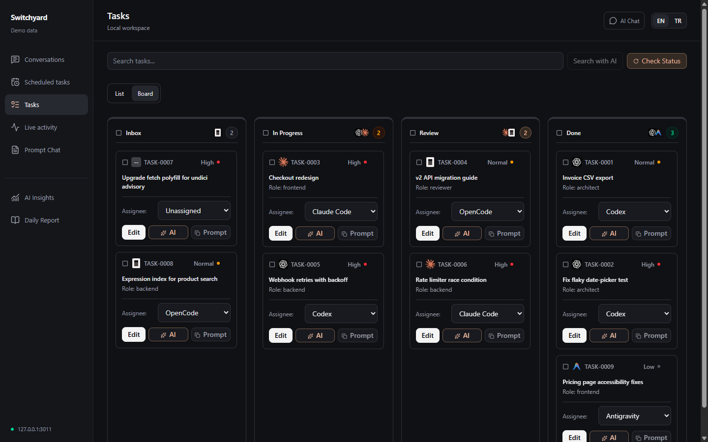
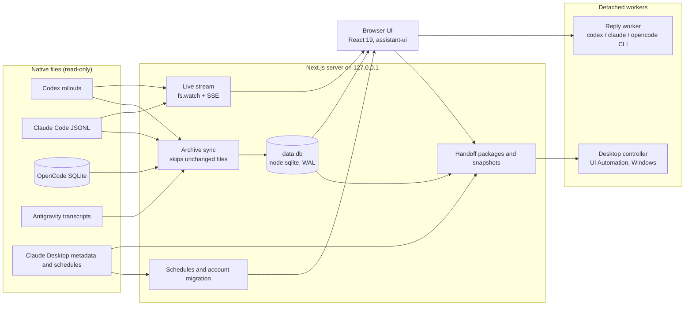

# Switchyard

One local yard for every AI coding session: search the archive, watch agents live, track schedules, and hand a chat to another account or tool when the limit hits.

Switchyard is a local web app (Next.js, runs on `127.0.0.1`) that reads the session files Codex, Claude Code, OpenCode and Antigravity already write to your disk. It keeps a searchable SQLite archive of them, streams open conversations as they change, lists the scheduled tasks of each tool with their run history, and packages a conversation so another account or another tool can continue it with verified context.



All screenshots in this README come from demo mode and show invented data (the fictional Acme projects and `example.com` accounts).

## Why

These are public reports from the tools' own issue trackers. Reaction and comment counts were checked on 2026-10-23.

**Usage limits stop work in the middle of a task, and the work has to move.**
[claude-code#16157](https://github.com/anthropics/claude-code/issues/16157) "Instantly hitting usage limits with Max" has 695 thumbs-up and 1,499 comments; [claude-code#38335](https://github.com/anthropics/claude-code/issues/38335) has 475 thumbs-up; [codex#28879](https://github.com/openai/codex/issues/28879) reports a five-hour budget gone in two or three prompts (365 thumbs-up). People keep a second account to get past this: multi-account switching is requested in [claude-code#18435](https://github.com/anthropics/claude-code/issues/18435) (941 thumbs-up) and [claude-code#36151](https://github.com/anthropics/claude-code/issues/36151) (767). Continuing after the limit is asked for in [claude-code#13354](https://github.com/anthropics/claude-code/issues/13354) (209) and [codex#21073](https://github.com/openai/codex/issues/21073) (87), and an explicit session handoff in [claude-code#11455](https://github.com/anthropics/claude-code/issues/11455) (26 thumbs-up, 41 comments). The current workaround is writing a HANDOFF.md by hand, because the next tool starts with no memory of the chat.

**Session history is scattered, hard to search, and sometimes lost.**
[claude-code#28791](https://github.com/anthropics/claude-code/issues/28791) asks to sync history between the CLI and Desktop (155 thumbs-up). [claude-code#41458](https://github.com/anthropics/claude-code/issues/41458) reports 490 sessions deleted despite `cleanupPeriodDays` set to 99999. [codex#12564](https://github.com/openai/codex/issues/12564) asks for named threads to make history navigable (114 thumbs-up, 81 comments). The Cursor forum has repeated threads about chat history lost after updates.

**Parallel agents have no single view.**
Individual requests such as [claude-code#24537](https://github.com/anthropics/claude-code/issues/24537) (agent dashboard) have few votes, but tools that fill the gap are widely installed: vibe-kanban and cmux each have about 28,000 GitHub stars.

**Scheduled agents give no reliable record of what ran.**
[claude-code#95966](https://github.com/anthropics/claude-code/issues/95966) describes 14 scheduled tasks that silently skipped their run times; [#95272](https://github.com/anthropics/claude-code/issues/95272) and [#89811](https://github.com/anthropics/claude-code/issues/89811) describe runs reported as succeeded that did nothing; [#102677](https://github.com/anthropics/claude-code/issues/102677) reports the run-history panel was removed.

**Moving setups between accounts and machines is manual.**
[claude-code#20697](https://github.com/anthropics/claude-code/issues/20697) asks to sync skills between Desktop and the CLI (162 thumbs-up).

## What Switchyard does

| Problem | What Switchyard does |
|---|---|
| Limit hit mid-task | **Handoff.** Builds a continuation package from a conversation: a Markdown brief (turns, touched files, open tasks and questions, Git state), the redacted transcript, the byte-exact native session file and the project's instruction files, each with a SHA-256 hash. Single chats can be copied into any tool. On Windows, a batch of chats can be delivered to a new Claude Desktop account, with account checks and proof of delivery. |
| Scattered history | **Archive.** Imports Codex, Claude Code, OpenCode and Antigravity sessions into one SQLite database that keeps them after the tool deletes or rotates its own files. Search by project, title or session, filter by time, read full transcripts with tool calls, reasoning summaries and images. |
| No single view of agents | **Live view.** Open conversations update as the native file grows (server-sent events with file watching). An activity log and agent grid show what each agent reported, with `@mentions` between agents and roles. |
| No record of scheduled runs | **Schedules.** Lists Codex automations, Claude Desktop scheduled tasks and Antigravity schedules in one place, with enable/pause, and a run history that joins each Claude scheduled run with the last real reply in its transcript, so a run that did nothing shows up as such. |
| Moving setups between accounts | **Account migration.** Detects the active Claude Desktop account and copies scheduled-task definitions from the previous account to the new one; copies Claude tasks to Codex automations; copies skills to every Claude account on the machine. |

It also includes a reply box that resumes a native session through the tool's own CLI, a task board, prompt drafts, an AGENTS.md editor, and optional local AI helpers through Ollama.

## Screenshots

| | |
|---|---|
|  |  |
| A Claude Code transcript with its tool activity, ending at the usage limit. | A two-chat handoff package delivered to another account, with reply and title checks. |
|  |  |
| Scheduled tasks across accounts with run history and outcomes. | The activity log and agent grid. |
|  | |
| The task board. | |

## Quickstart

Requirements: Node.js 22.13 or later (24 LTS recommended; Switchyard uses the built-in `node:sqlite`), npm, Git.

### 1. Demo mode (start here)

```bash
git clone https://github.com/huseyinkaplandev/switchyard.git
cd switchyard
npm ci
npm run demo
```

Open http://127.0.0.1:3011. `npm run demo` builds the app if needed, generates a synthetic home directory in `.demo/` (15 conversations across the four tools, two Claude accounts, scheduled tasks with run history, a task board, an activity log and a sample handoff package) and starts the server against it.

In a second terminal, `npm run demo:live` appends to one conversation and to the activity log every few seconds, so you can watch the live stream.

Demo mode never reads your real home directory: every path resolves inside `.demo/`, and it refuses to start if that path is your real profile. Actions that would affect your machine (restarting Claude Desktop, resuming a CLI, opening apps, skill sync, Ollama) return a "Demo mode" message or a simulated result instead.

### 2. Real mode

```bash
npm ci
npm run build
npm start
```

Open http://127.0.0.1:3010. Nothing needs configuring: Switchyard reads whatever native histories exist under your home directory. The first page load imports the archive; later loads refresh it in the background.

Optional:

- **Windows autostart:** `powershell -ExecutionPolicy Bypass -File windows\Install-Autostart.ps1` registers a per-user Scheduled Task with a watchdog. Remove it with `windows\Uninstall-Autostart.ps1`.
- **macOS:** double-click `macos/start-switchyard.command`, or run `macos/install-launch-agent.sh` for a login item.
- **Activity log CLI:** `npm run build` also builds `cli/`. Then `node cli/dist/bin/log-agent.js codex backend "TASK-0005 done"` appends to the activity log, and `.githooks/post-commit` logs commits from a project that sets `git config core.hooksPath <path-to-switchyard>/.githooks`.
- **Development server:** `npm run dev` (Turbopack, port 3010).

### Configuration

| Variable | Default | Purpose |
|---|---|---|
| `SWITCHYARD_DATA_DIR` | `~/.switchyard` | Archive database, handoff packages, snapshots, tasks, logs |
| `SWITCHYARD_PORT` | `3010` (`3011` for the demo) | Server port; the host is always `127.0.0.1` |
| `SWITCHYARD_TIMEZONE` | system zone | Zone used for "today" filters |
| `SWITCHYARD_MAC_HOME` | unset | A read-only copy of a Mac home folder, for example one synced with `scripts/export-mac-data.mjs` |
| `SWITCHYARD_SKILLS_BUNDLE` | `<data dir>/skills` | Folder that skill sync writes the newest copy of every skill to |
| `CODEX_HOME`, `ANTIGRAVITY_HOME`, `OPENCODE_HOME` | tool defaults | Same meaning as in the tools themselves |
| `OLLAMA_BASE_URL`, `OLLAMA_MODEL` | `http://127.0.0.1:11434`, `qwen2.5:3b` | Optional local AI helpers |
| `SWITCHYARD_DEMO`, `SWITCHYARD_DEMO_ROOT` | unset | Set by `npm run demo` |

## Supported tools

| Tool | What is read | Windows | macOS | Archive, search, live | Reply (resume CLI) | Schedules |
|---|---|---|---|---|---|---|
| Codex | `~/.codex/sessions/**/rollout-*.jsonl`, `archived_sessions/`, `session_index.jsonl`, `automations/*/automation.toml` | yes | yes | yes | `codex exec resume` | read, pause/enable, copy from Claude |
| Claude Code | `~/.claude/projects/*/*.jsonl`, `~/.claude/scheduled-tasks/*/SKILL.md` | yes | yes | yes | `claude --print --resume` | via Claude Desktop |
| Claude Desktop | `%APPDATA%\Claude\` or `~/Library/Application Support/Claude/`: `config.json`, `claude-code-sessions/<account>/<org>/` session metadata and `scheduled-tasks.json` | yes | yes | metadata for titles, accounts and handoff | no | read, pause/enable, account migration, run history |
| OpenCode | `~/.local/share/opencode/opencode.db` (read-only SQLite) | yes | yes | yes (no live tail) | `opencode run --session` | no |
| Antigravity | `~/.gemini/antigravity/brain/<id>/.system_generated/logs/transcript*.jsonl`, `agyhub_summaries_proto.pb`, `~/.gemini/config/sidecars/` | yes | yes | yes | no | read, pause/enable |
| VS Code Copilot Chat, VS Code Insiders, Cursor, Kiro | their chat stores under the app's user data folder | yes | yes | listed and readable under "All local records" | no | no |

Switchyard opens native files read-only. It writes to native files only when you press a button that says so (pausing a task, copying tasks, migrating or installing schedules, saving skills), and it backs up every file before such a write.

## How handoff works

Single chat (any tool): open a conversation, choose **Actions > Get handoff**. Switchyard builds the brief and a context snapshot in `<data dir>/context-snapshots/<id>/` and gives you a continuation prompt to paste into the next tool.

Batch delivery to a new Claude Desktop account (Windows):

1. **Catalog.** Joins archived Claude Code and Codex conversations with Claude Desktop metadata to know each chat's title, working directory, account and whether it was a scheduled run.
2. **Package.** For each selected chat (1 to 50), writes `transcript.json` (secrets redacted by pattern), `handoff.md`, `prompt.txt` and `git.json`, records their SHA-256 hashes in `manifest.json`, and hashes the manifest. Files are written to a staging folder with exclusive-create and renamed into place atomically. Each item also gets a context snapshot with the byte-exact native session file. Requests must come from the same loopback origin.
3. **Verify before acting.** The controller rejects packages outside the data folder or behind symlinks and re-checks every hash. A global lock and a per-package lock allow one controller at a time.
4. **Account check.** It reads the Claude Desktop conversation that is open now, finds exactly one matching metadata record, and takes the account from it. The destination account must differ from the source account, and the source operating system must match.
5. **Delivery.** A small C# helper (UI Automation, run through Windows PowerShell) creates a new chat in the original working directory, pastes the prompt, verifies it, sends it, and renames the chat to the exact source title. Before every input it checks that the foreground window belongs to Claude, and it aborts if focus changes. Chats that share a working directory are sent one after another.
6. **Proof of delivery.** An item counts as delivered only when the native transcript contains the item's unique marker, followed by a real assistant reply (not a synthetic or API error message) in the right directory, and the title reads back exactly. States are prepared, queued, opening, opened, sent, reply-observed, failed and uncertain. An uncertain item is never sent again automatically.
7. **Scheduled chats** get an extra boundary in the prompt: rebuild context, take no external action without fresh approval, and do not recreate the recurring task.

For a Codex Desktop destination the package contains written instructions for the receiving chat, which has to use its own native thread tools; Switchyard does not automate the Codex UI.

## Architecture



- `ui/`: the Next.js app. Server code is in `ui/app/_lib/`, routes in `ui/app/api/`, workers and their tests in `ui/scripts/`.
- `cli/`: `log-agent` (append to the activity log) and `switchyard-sync` (trigger an archive sync on an interval).
- `scripts/`: Claude scheduled-task sync across accounts, skill sync, Mac export, and the demo launcher.
- `fixtures/demo/`: the generator for the synthetic demo world.
- `windows/`, `macos/`: start, autostart and watchdog scripts.

## Privacy

- The server binds to `127.0.0.1` only. Routes that write native files, start processes or build handoff packages reject requests from another origin.
- There is no telemetry, analytics or remote call. The only network traffic is between your browser and the local server, plus the optional Ollama endpoint you configure.
- Native session files and databases are opened read-only. Images are served from the original file on request and never copied into the database.
- Handoff text is passed through pattern-based secret redaction (API keys, tokens, private keys, JWTs). This is a heuristic: the native session copies in a snapshot are byte-exact and can contain secrets, so keep snapshot folders local.

## Limitations

- Batch delivery through Claude Desktop works on Windows only. On macOS the catalog, packages and snapshots work, but GUI delivery is disabled.
- The Desktop controller drives the Claude Desktop UI. An app update that changes the window structure can break it until the helper is adjusted; failures stop delivery rather than guess.
- Codex as a receiving side is instructions only: the receiving Codex chat has to use its own tools.
- Moving a chat between operating systems needs a working-directory mapping, which is not implemented.
- A handoff is a summary plus evidence, not a transfer of model state. Hidden or encrypted reasoning, running processes and remote-only history cannot be carried over.
- OpenCode conversations are re-read on sync but not tailed live. VS Code, Insiders, Cursor and Kiro are listed read-only and are not part of the archive or handoff.
- Linux runs the build and the tests in CI, and the archive works with the same home-relative paths, but desktop features and some adapters assume Windows or macOS folder layouts.
- The formats Switchyard reads are the tools' private on-disk formats. They change without notice; the parsers are versioned and re-import when they change, but a new format can need a parser update.
- The interface is in English with a Turkish option.

## Compared with existing tools

Each of these does its own job well; Switchyard overlaps with parts of several of them.

| Tool | Focus | Where Switchyard differs |
|---|---|---|
| vibe-kanban | Kanban board that runs agents in worktrees | Switchyard does not orchestrate new agent runs; it archives, watches and hands off existing sessions |
| cmux | Terminal tabs with agent notifications (macOS) | Switchyard is a browser UI on Windows and macOS, with history and search |
| opcode (claudia) | GUI for Claude Code sessions and background agents | Switchyard covers four tools in one archive, but has no agent builder |
| ccusage, Claude-Code-Usage-Monitor | Token, cost and limit tracking | Switchyard does not measure usage; it helps after the limit hits |
| agentsview, claude-code-history-viewer, cass | Search and viewing across many agents (50+, about 31 and 23 respectively) | They read more tools. Switchyard reads four in depth and adds live view, schedules and handoff |
| claude-squad, superset, crystal | Running several agents in parallel | Switchyard does not start parallel runs |
| ccx | Two-way Claude and Codex sync at the limit (macOS) | Switchyard packages context with hashes for any tool and automates delivery to Claude Desktop on Windows |

## Development

```bash
npm ci
npm run typecheck   # tsc --noEmit in ui/ and cli/
npm test            # node:test suites in ui/scripts (80 tests)
npm run build       # Next.js production build and the CLI
```

The tests cover the native parsers (Codex rollouts, Claude Code queue records, Antigravity transcripts, OpenCode parts), the conversation list, transcript images, handoff integrity and snapshot hashing, the reply worker and its locking, the Desktop controller with a fake adapter (account checks, uncertain-delivery handling, tampering), the scheduler, Claude schedule migration across accounts, Claude-to-Codex task copies and skill sync. The C# UI Automation helper has its own checks in `ui/scripts/desktop-handoff/windows/Controller.test.ps1`.

## Roadmap

- A macOS delivery adapter, after a pilot on real accounts.
- Working-directory mapping so a chat can move between Windows and macOS.
- Live tailing for OpenCode.
- Archive import for VS Code Copilot Chat and Cursor, not only listing.
- A packaged desktop build so Node is not a prerequisite.

## License

[MIT](LICENSE). Third-party notices are in [THIRD_PARTY_NOTICES.txt](THIRD_PARTY_NOTICES.txt).

Product names and logos are trademarks of their owners, used only to identify the tools Switchyard reads; no endorsement implied.
